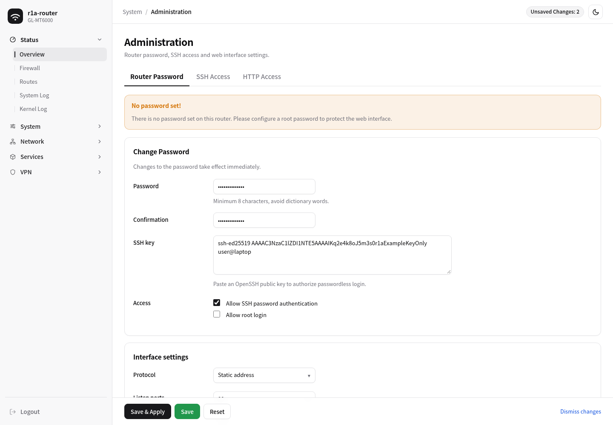
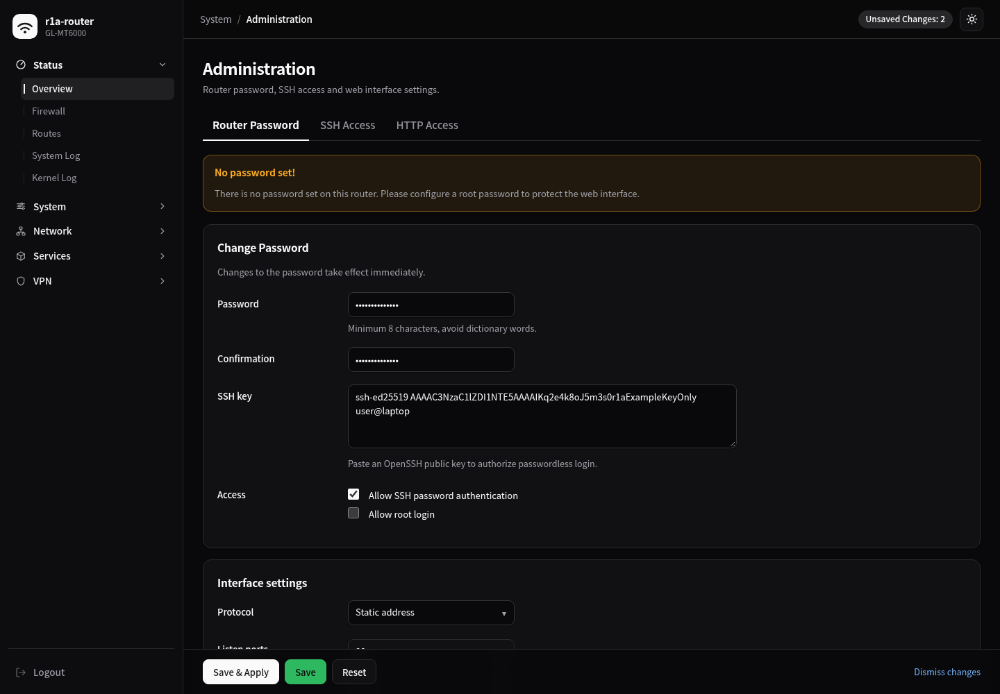
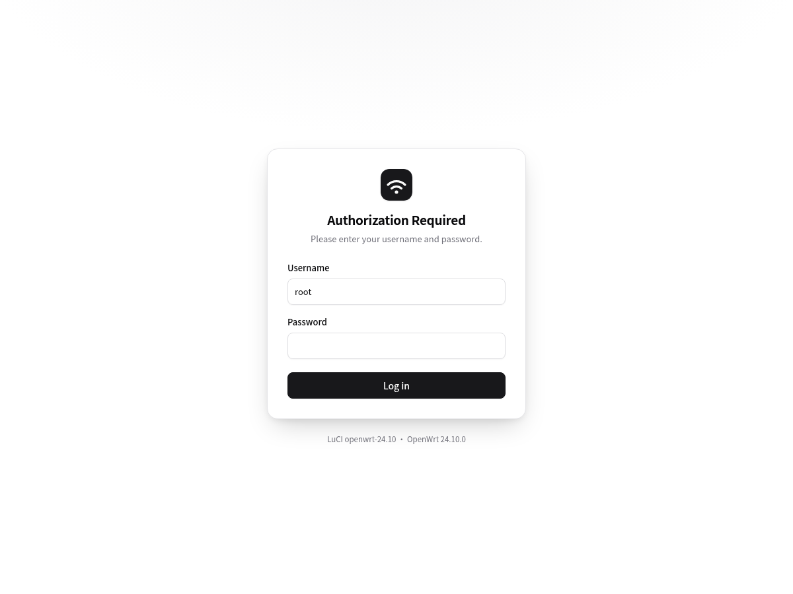

# luci-theme-r1a

一个 shadcn/ui 风格、响应式、自带明暗双主题的 OpenWrt LuCI 主题。

- 侧边栏导航 + 顶栏（Lucide 风格线性图标）
- shadcn "neutral" 色板与 CSS 变量 token，支持一键换肤
- 跟随系统深浅色，也可手动切换（`localStorage: r1a-theme`）
- 覆盖 LuCI 的 CBI 表单、表格、标签页、下拉框、动态列表、模态框、接口徽章、配置差异视图
- 移动端抽屉导航，表格自动堆叠为卡片

适用版本：**OpenWrt 24.10 及以后**（LuCI 已切换到 ucode 模板）。23.05 及更早的 Lua 模板体系需要另加 `luasrc/view/themes/r1a/*.htm`，本包暂未包含。





登录页：

> 以上截图来自仓库内的 `preview/` 静态预览页，不是真实路由器截图。

---

## shadcn 能直接用吗？

**组件不能，设计系统可以。**

| | shadcn/ui | LuCI |
|---|---|---|
| 渲染 | React + Radix | 原生 JS（`luci.js`/`ui.js`/`cbi.js`）生成 DOM |
| 样式 | Tailwind 工具类 | 主题只提供 CSS，类名由 LuCI 决定 |
| 主题机制 | `<ThemeProvider>` + `.dark` 类 | `luci.main.mediaurlbase` + `html[data-darkmode]` |

shadcn 的按钮、Dialog、Select 都是 React 组件，而 LuCI 的表单控件是 `cbi.js` 生成的固定 DOM（`.cbi-value`、`.cbi-dropdown`、`.cbi-section-table` …），主题无法替换它们的结构，只能给这些既有类名写样式。所以**不能把 shadcn 组件塞进 LuCI**。

但 shadcn 真正的价值在于它的设计 token 层，这部分完全可移植，本主题就是照这个思路做的：

1. 直接采用 shadcn 的 HSL 变量命名与取值（`--background`、`--foreground`、`--primary`、`--muted-foreground`、`--border`、`--ring`、`--radius`）；
2. 明暗主题通过 `html[data-darkmode="true"]` 覆盖同一组变量，正好对应 LuCI 自带的 `data-darkmode` 属性；
3. 圆角、焦点环、阴影、间距节奏全部由 token 派生；
4. 图标使用 Lucide 的线性风格（内联 SVG，无额外字体/网络请求）。

如果你想进一步用 Tailwind，可以把 `cascade.css` 拆成 `@theme` + `@layer components` 用 Tailwind CLI 预编译，但产物仍必须是单个静态 CSS，路由器上没有构建时。直接用原生 CSS 对 LuCI 这种「类名不可控」的场景更稳。

---

## 目录结构

```
luci-theme-r1a/
├── Makefile                              # LuCI feed 布局（feeds/luci/themes/...）
├── Makefile.sdk                          # 独立 SDK 布局（package/luci-theme-r1a）
├── scripts/build-apk.sh                  # 生成 dist/*.apk
├── dist/                                 # 预编译 apk
├── htdocs/luci-static/r1a/
│   ├── cascade.css                       # 全部样式（token + 组件 + 响应式）
│   └── logo.svg                          # 品牌角标 / favicon
├── htdocs/luci-static/resources/
│   └── menu-r1a.js                       # 侧边栏菜单、标签页、移动端抽屉、明暗切换
├── ucode/template/themes/r1a/
│   ├── header.ut                         # 页面骨架（侧栏 + 顶栏 + 内容容器）
│   ├── footer.ut                         # 关闭容器、版本信息、加载菜单
│   └── sysauth.ut                        # 登录页
├── root/etc/uci-defaults/30_luci-theme-r1a
├── preview/index.html                    # 纯静态设计预览（不依赖 LuCI）
└── docs/                                 # 预览截图
```

安装到路由器后的实际路径：

| 仓库路径 | 路由器路径 |
|---|---|
| `htdocs/luci-static/r1a/` | `/www/luci-static/r1a/` |
| `htdocs/luci-static/resources/menu-r1a.js` | `/www/luci-static/resources/menu-r1a.js` |
| `ucode/template/themes/r1a/` | `/usr/share/ucode/luci/template/themes/r1a/` |
| `root/etc/uci-defaults/30_luci-theme-r1a` | `/etc/uci-defaults/30_luci-theme-r1a` |

---

## 安装

### 方式零：直接安装预编译 apk（推荐）

仓库内已附带构建好的包：

```
dist/luci-theme-r1a-1.0.6-r1.apk
```

适用 **OpenWrt snapshot / 25.12 及以后**（apk-tools 3）。24.10 及更早使用 opkg，不能安装 `.apk`。

包已用项目 EC 密钥签名，公钥在 `dist/r1a.ec.pub`。**先导入公钥**，之后正常安装即可（包括 LuCI 网页上传安装）：

```sh
scp dist/r1a.ec.pub root@192.168.1.1:/etc/apk/keys/
scp dist/luci-theme-r1a-1.0.6-r1.apk root@192.168.1.1:/tmp/

ssh root@192.168.1.1 'apk add /tmp/luci-theme-r1a-1.0.6-r1.apk'
```

不想导入公钥时，也可以单次放行未签名/未知密钥的包：

```sh
apk add --allow-untrusted /tmp/luci-theme-r1a-1.0.6-r1.apk
```

> 如果执行 `apk add` 仍报 `UNTRUSTED signature`，说明公钥没有放进 `/etc/apk/keys/`，或者你用的是其他密钥重新打包的版本。

安装后会自动登记主题，并在当前主题为 Bootstrap 或无主题时切换到 r1a；`post-install` 会清理 LuCI 缓存。

卸载：

```sh
apk del luci-theme-r1a
```

卸载脚本会在当前主题是 r1a 时回退到 `/luci-static/bootstrap`。

### 方式一：OpenWrt SDK / 固件编译
```sh
# 把仓库软链或拷贝进 SDK 的 package/ 目录
ln -s /path/to/luci-theme-r1a package/luci-theme-r1a

make menuconfig     # LuCI -> Themes -> luci-theme-r1a
make package/luci-theme-r1a/compile V=s
```

生成的 `.ipk`/`.apk` 位于 `bin/` 下，装到路由器即可，安装脚本会自动登记主题并设为默认。

### 方式二：手动部署到已运行的路由器

```sh
ROUTER=root@192.168.1.1

ssh $ROUTER 'mkdir -p /www/luci-static/resources \
  /usr/share/ucode/luci/template/themes'

scp -r htdocs/luci-static/r1a          $ROUTER:/www/luci-static/
scp htdocs/luci-static/resources/menu-r1a.js \
    $ROUTER:/www/luci-static/resources/
scp -r ucode/template/themes/r1a       $ROUTER:/usr/share/ucode/luci/template/themes/
scp root/etc/uci-defaults/30_luci-theme-r1a $ROUTER:/etc/uci-defaults/

ssh $ROUTER '
  uci set luci.themes.R1A="/luci-static/r1a"
  uci set luci.main.mediaurlbase="/luci-static/r1a"
  uci commit luci
  rm -f /tmp/luci-indexcache.*
  /etc/init.d/rpcd reload
'
```

强制刷新浏览器缓存（Ctrl/Cmd + Shift + R）后即可看到新主题。

### 回退 / 切换

```sh
# 回到官方 Bootstrap
uci set luci.main.mediaurlbase='/luci-static/bootstrap'
uci commit luci

# 或使用 LuCI 里已登记的其他主题
uci show luci.themes
```

### 重新打包 apk

预编译包由 `scripts/build-apk.sh` 生成，只依赖 apk-tools 3（OpenWrt SDK 自带）：

```sh
APK=/path/to/openwrt-sdk/staging_dir/host/bin/apk ./scripts/build-apk.sh
# -> dist/luci-theme-r1a-1.0.6-r1.apk
```

脚本会自动用 `unshare -r` 把包内文件属主设为 `root:root`；如果系统不允许 user namespace，则需要以 root 运行。

签名密钥默认读取 `.signing/r1a.ec.key`（已 gitignore，不随仓库分发），存在时会自动签名并导出 `dist/r1a.ec.pub`；也可以用 `SIGN_KEY=/path/to/your.key` 指定其他 EC 私钥。没有密钥时生成的是未签名包，安装需要 `apk add --allow-untrusted`。

已验证：在 `openwrt/rootfs:x86-64-SNAPSHOT` 容器中安装后，`luci.main.mediaurlbase` 自动指向 `/luci-static/r1a`，三个 ucode 模板均可被 `ucode -T` 编译。

---

## 自定义

所有可调项都在 `htdocs/luci-static/r1a/cascade.css` 顶部：

```css
:root {
	--background: 0 0% 100%;      /* hsl 三段值，不带 hsl() */
	--foreground: 240 10% 3.9%;
	--primary: 240 5.9% 10%;      /* 主按钮、选中项 */
	--muted-foreground: 240 3.8% 46.1%;
	--border: 240 5.9% 90%;
	--ring: 240 6% 32%;           /* 焦点环 */
	--radius: 0.75rem;
	--sidebar-width: 264px;
	--font-sans: ui-sans-serif, system-ui, ...;
}
```

深色主题是同一组变量，定义在 `html[data-darkmode="true"]` 下。想换主题色，只改 `--primary` 与 `--ring` 即可；想让整体更「shadcn」，保持中性灰即可，不要加渐变。

- **换品牌图标**：替换 `logo.svg`（favicon 与侧栏共用）。
- **换菜单图标**：编辑 `menu-r1a.js` 顶部的 `ICONS` 表，key 是 LuCI 菜单节点名（`status`、`system`、`network`、`services`、`vpn`、`nas`、`docker`…），未命中时回退到 `default`。
- **默认配色**：LuCI 的 `ifacebox-head`、`zonebadge` 等会带内联背景色，主题保留这些内联样式以便区分网络区域。

---

## 本地预览

`preview/index.html` 复刻了 LuCI 的真实 DOM 结构，直接用浏览器打开即可（无需 LuCI）：

```sh
xdg-open preview/index.html          # 浅色
xdg-open 'preview/index.html#dark'   # 深色
```

预览里包含表单、下拉、动态列表、表格、接口徽章、配置差异和吸底操作栏，可用来调样式。注意它只是静态还原，不包含 LuCI 的 JS 行为。

---

## 实现要点

- **模板**：`header.ut` 负责输出 `<html>`、色板脚本、侧栏和顶栏，并保持 `#maincontent` 打开；`footer.ut` 关闭容器并 `L.require('menu-r1a')`。`#indicators`、`#tabmenu`、`#modemenu`、`#topmenu` 等 ID 与 LuCI 约定保持一致，这样 `ui.showIndicator()`、`ui.tabs` 等原生逻辑无需修改。
- **菜单**：通过 `ui.menu.load()` + `ui.menu.getChildren()` 渲染。父级分组可折叠，当前分组默认展开；`logout` 固定在侧栏底部。
- **深色模式**：`header.ut` 在首屏渲染前读取 `localStorage` 或 `prefers-color-scheme`，把结果写入 `html[data-darkmode]`；顶栏按钮负责切换并持久化。
- **登录页**：`sysauth.ut` 是独立居中卡片，不依赖 `ui.instantiateView`，并保留官方模板里的 HTTPS 自动跳转探测。
- **页面布局契约**：`#maincontent` 是唯一的布局容器（宽度、padding、底部操作栏都以它为准）；`#view` 设为 `display: contents`，`.cbi-map` 不产生视觉盒模型。因此无论页面走 JS 视图、模板视图还是 `form.Map`，外层几何与顶层间距都一致，不会出现“有的页面多一层容器”的差异。
- **表格移动端**：利用 LuCI 写在 `.td` 上的 `data-title` 属性，把 `.cbi-section-table` 的行转成卡片。

---

## 已知限制

- 只包含 ucode 模板，适用于 OpenWrt 24.10+ / LuCI master。
- shadcn 的交互组件（Radix Dialog、Dropdown）没有移植；下拉、模态框沿用 LuCI 自带实现，仅做视觉重绘。
- 侧边栏布局与官方 Bootstrap 的顶栏布局差异较大，若某些第三方插件写死了 `header .nav` 之类的选择器，可能需要单独适配。
- `preview/` 仅用于开发预览，不会被打进安装包（不参与 `Makefile` 的 `htdocs` 安装）。

## 更新记录

- **1.0.6**
  - 表格长内容自动换行，DHCPv6 租约等表格不再撑破容器。
  - 防火墙 Zones 表格内的控件填满单元格，操作按钮不再堆叠或越界。
  - 进程表格使用固定列宽：Command 自适应，其余列宽度稳定。
  - 修复 repokeys 公钥输入框宽度（`DummyValue` 的 `<output>` 撑满行）。
  - 嵌套 `.cbi-section` 不再生成第二层卡片，Flash 等页面层次更清晰。
- **1.0.5**
  - 修正 `.left` / `.right` / `.center` 工具类语义：它们是文字对齐（LuCI 会用在表格单元格上），不是浮动；浮动仍由 `.pull-left` / `.pull-right` 负责。修复 package-manager 等页面表头被拆散的问题。
- **1.0.4**
  - 计划任务等页面级 `textarea` 恢复全宽；表单字段内的 `textarea` 仍保持 560px 阅读宽度。
- **1.0.3**
  - 统一页面布局：`#maincontent` 作为唯一容器，`#view` 透明化（`display: contents`），`.cbi-map` 不参与盒模型；统一首尾元素间距。JS 视图、模板视图和 `form.Map` 页面的外层几何现在完全一致。
- **1.0.2**
  - 修复空的多选下拉（如 DNS 缓存/过滤记录类型）被撑到数百像素高的问题：多选项改为单行收缩，空状态折叠列表。
  - 修复 tabbed 表单中未激活标签页仍占 `padding + border + margin` 导致的大块空白（Interfaces 等页面）。
  - CSS 链接带 `?v=` 版本号，升级后无需手动强刷。
- **1.0.1**
  - 修复 `Save & Apply` 组合按钮文字与按钮同色（黑底黑字）。
  - 修复系统日志文本框被限制在 560px 宽。
  - 修复 startup 等多按钮表格单元格内按钮无间隙。

## License

Apache-2.0。页面骨架与部分兼容代码参考自 [LuCI](https://github.com/openwrt/luci)（Apache-2.0）。
